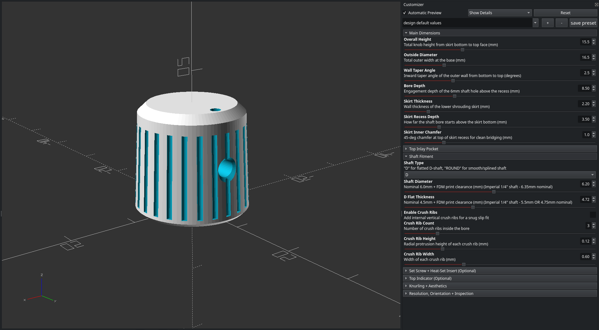

# 🎛️ MyKnob

**Precision Parametric Rotary Encoder & Potentiometer Knob Generator for OpenSCAD.**

Whether you are building a custom mechanical keyboard, restoring a vintage synthesizer, or upgrading your audio gear, **MyKnob** lets you generate custom, press-fit, or set-screw knobs tailored to your exact hardware in seconds.

**Play with MyKnob until it fits your exact specifications.**

`MyKnob` is a fully parametric OpenSCAD generator designed for 3D printing custom rotary encoder and potentiometer knobs. Built with native **OpenSCAD Customizer** support, it gives you granular control over shaft tolerances, knurling textures, shrouded skirts, top inlays, and locking hardware; it also includes a built-in cutaway inspection tool so you can examine your internals before committing to a print.

---

## ✨ Features

* **Precision Shaft Fitment:** Supports both **D-shaft** (flatted) and **Round/Splined** 6mm shafts with `0.01 mm` step controls for dialing in friction fits on any FDM printer.
* **Internal Crush Ribs:** Toggleable vertical crush ribs (`2` to `8` ribs) that automatically calculate D-flat clearance angles, giving you a snug slip fit without splitting layer lines.
* **Shrouded & Flared Skirt:** Recesses the shaft bore upward inside a solid-walled skirt to cover encoder mounting nuts and bushings with minimal panel gap. Includes an optional **conical skirt flare**, outer wall taper, and internal 45° bridging chamfers.
* **Custom Knurling & Grip:** Switch between **Diamond** (helical cross-cut), **Vertical** (straight flutes), or **Smooth** finishes with adjustable groove count, pitch angle, depth, and top/bottom smooth margins.
* **Top Inlay Pocket & Glue Vent:** Add a recessed pocket (with optional inner lip bevel) for wood, abalone, or multi-color 3D-printed top disks. Includes an optional central pin hole to vent trapped glue/air and allow non-destructive inlay removal.
* **Set-Screw & Heat-Set Insert Support:** Optional radial set-screw bore aligned directly with the D-shaft flat, complete with an outer countersink chamfer and an expandable counterbore for **brass heat-set inserts**.
* **Top and Side Position Indicator:** Optional raised or recessed **Dot** or **Notch** on the top face, with or without side indicator along the main body, and a `-180°` to `+180°` orientation slider relative to the D-shaft flat.
* **Built-In Cross-Section Inspector:** Toggle a real-time cutaway view with a `360°` rotating cut plane to verify wall thicknesses, crush rib engagement, and set-screw depth right inside OpenSCAD.
---

## 🚀 Getting Started

### 1. Install OpenSCAD
Download and install [OpenSCAD](https://openscad.org). 
> **Tip:** For dramatically faster rendering speeds (especially with heavy knurling), grab a recent **Development Snapshot** from the OpenSCAD downloads page and enable **Manifold** under *Edit > Preferences > Features*.

### 2. Customize MyKnob
1. Download `myknob.scad` (and `myknob.json` if using presets) from this repository.
2. Open `myknob.scad` in OpenSCAD.
3. Open the Customizer panel by navigating to **Window > Customizer** in the top menu (make sure *Hide Customizer* is unchecked).
4. Measure your shaft and dial in your preferred dimensions, grip style, and indicator marks.

### 3. Render & Export
1. Press **F5** for a quick preview while adjusting parameters.
2. Press **F6** to perform a full CGAL/Manifold render.
3. Press **F7** to export your finished knob as an `.stl` file ready for slicing.

---

## 📏 How to Measure Your Shaft

Before printing, grab a pair of calipers and check your encoder or potentiometer:

| Measurement | Common Metric Sizes | Common Imperial Sizes |
| :--- | :--- | :--- |
| **Nominal Diameter** | **6.0 mm** *(EC11, PEC11, most modern synths & keyboards)* | **6.35 mm / 1/4"** *(Pro-audio gear, guitar pedals, amps)* |
| **Shaft Profile** | **D-Shaft** (4.5 mm flat), **T18 Splined** (18 teeth), **Round** | **Round** (set screw), **D-Shaft** (5.5 mm / 4.75 mm flat), **24T Splined** |
| **Shaft Length** | **15 mm** (keyboards), **20 mm** (panel-mount synths) | **1/2" (12.7 mm)**, **3/4" (19.05 mm)** |

---

## 🖨️ 3D Printing Tips

* **Orientation:** Print upright (skirt down) when using a top inlay pocket or concave features so internal overhangs bridge cleanly. Enable **Auto Flip Flat Top** if printing a flat-topped knob (`Inlay Depth = 0`) upside-down.
* **Layer Height:** Use **0.12 mm – 0.16 mm** layer heights for crisp diamond knurling and smooth chamfers.
* **Dialing in the Fit:** Every printer's extrusion multiplier and filament shrinkage is slightly different. If the fit is too tight or too loose, adjust the `Shaft_Diameter` and/or `D_Flat_Thickness` parameters in increments of **0.05 mm** rather than scaling the whole model in your slicer.
* **Seam Position:** Set to **Aligned** or **Rear** in your slicer to keep random seam "zits" off your knob.
* **Multi-Color Indicators:** Print with a filament change (M600) at the indicator layer, or fill recessed top indicator lines with acrylic paint or a paint pen for high contrast.
* **Material:** Matte PLA, PLA-CF, or PETG-CF hides layer lines exceptionally well and gives the knurling a professional look and feel.

---

## Presets

`MyKnob` ships with a companion `MyKnob.json` preset file containing ready-to-print configurations you can load directly in OpenSCAD:

* **Default - Shrouded Inlay (15mm):** Standard diamond-knurled knob with a 10 mm top inlay pocket and recessed skirt.
* **Flared Synth / Audio Knob (20mm):** Classic tapered, flared-skirt knob with vertical flutes, a top indicator dot, and an M3 set-screw hole.
* **Low-Profile Slip-Fit (13mm):** Compact flat-top knob with 3 internal crush ribs and auto-flip enabled for fast upside-down printing.
* **Heavy Locking Heat-Set (22mm):** Wide, tall control knob built for an M3 brass heat-set insert, deep diamond knurling, and a top indicator notch.

### Using & Saving Presets

1. Keep `MyKnob.json` in the **exact same folder** as `MyKnob.scad` with matching filenames.
2. Open `MyKnob.scad` in OpenSCAD and select any profile from the **Preset** dropdown at the top of the Customizer panel.
3. To save your own custom configuration, click the **`+`** button next to the Preset dropdown in OpenSCAD. This automatically writes your new preset into `MyKnob.json`.

---

## 🤝 Contributing & Remixes

Found a bug, have a feature idea, or dialed in a great preset for a specific synthesizer or macro pad? Feel free to open an **Issue** or submit a **Pull Request**!

## Customizer Parameter Reference

| Section | Key Controls |
| :--- | :--- |
| **Main Dimensions** | `Overall Height`, `Outside Diameter`, `Wall Taper Angle`, `Skirt Flare Diameter`, `Skirt Flare Height`, `Skirt Flare Start`, `Bore Depth`, `Skirt Thickness`, `Skirt Recess Depth`, `Skirt Inner Chamfer` |
| **Top Inlay Pocket & Vent** | `Inlay Diameter`, `Inlay Depth`, `Inlay Chamfer`, `Enable Glue Vent`, `Glue Vent Diameter` |
| **Shaft Fitment & Crush Ribs** | `Shaft Type` (`D` / `ROUND`), `Shaft Diameter`, `D Flat Thickness`, `Enable Crush Ribs`, `Crush Rib Count`, `Crush Rib Height`, `Crush Rib Width` |
| **Set Screw & Heat-Set Insert** | `Enable Set Screw`, `Set Screw Diameter`, `Set Screw Offset`, `Set Screw Chamfer`, `Enable Heat Set`, `Heat Set Diameter`, `Heat Set Depth` |
| **Top Indicator** | `Top Indicator` (`NONE` / `DOT` / `NOTCH`), `Top Indicator Mode` (`RECESSED` / `RAISED`), `Indicator Side Drop`, `Side Indicator Mode` (`RECESSED` / `RAISED`), `Indicator Angle`, `Indicator Size`, `Indicator Depth`, `Indicator Offset` |
| **Knurling & Aesthetics** | `Knurl Style` (`DIAMOND` / `VERTICAL` / `NONE`), `Knurl Count`, `Knurl Angle`, `Knurl Depth`, `Knurl Width`, `Knurl Top Margin`, `Knurl Bottom Margin`, `Knurl Round Ends`, `Top Edge Sytle` (`CHAMFER` / `FILLET`), `Top Chamfer`, `Top Chamfer Angle`, `Top Fillet Conic`, `Bottom Chamfer`, `Bottom Chamfer Angle` |
| **Resolution, Orientation & Inspection** | `Circle Resolution`, `Auto Flip Flat Top`, `Show Cross Section`, `Cross Section Angle` |

## 🤖 AI Disclosure

Local AI tools were used to assist with drafting the OpenSCAD code, refining parametric math, and writing documentation for this project. All generated code has been reviewed and tested.

## 📄 License

This project is open-source and licensed under the **MIT License** -- see the [LICENSE](LICENSE) file for details.

